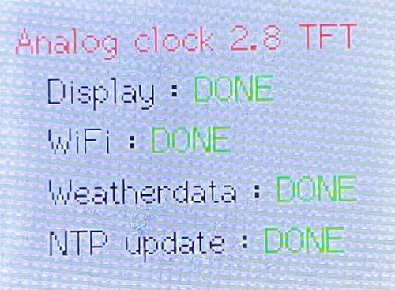
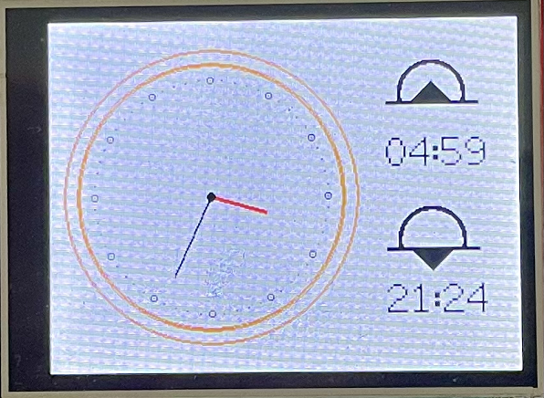

|[:skull:ISSUE](https://github.com/frankyhub/Analoguhr_TFT/issues?q=is%3Aissue)|[:speech_balloon: Forum /Discussion](https://github.com/frankyhub/Analoguhr_TFT/discussions)|[:grey_question:WiKi](https://github.com/frankyhub/Analoguhr_TFT/wiki)||
|--|--|--|--|
| | | | |
<a href="https://github.com/frankyhub/Analoguhr_TFT/issues">|<a href="https://github.com/frankyhub/Analoguhr_TFT/discussions">|<a href="https://github.com/frankyhub/Analoguhr_TFT/6eleases">||
|| <a href="https://github.com/frankyhub/Analoguhr_TFT/pulse" alt="Activity">| <a href="https://github.com/frankyhub/Analoguhr_TFT/graphs/traffic">  |<a href="https://github.com/frankyhub?tab=stars"> ||

# Analoguhr_TFT
### ESP32, TFT 2.8"

 
   

### Analoguhr mit der Anzeige für Sonnenauf- und Sonnenuntergang

 
   

---

   
<ol class="breadcrumb" style="border-top: 2px solid black;border-bottom:2px solid black; height: 45px; width: 900px;"> 
<a href="#oben">nach oben</a>
</ol>

  

---

